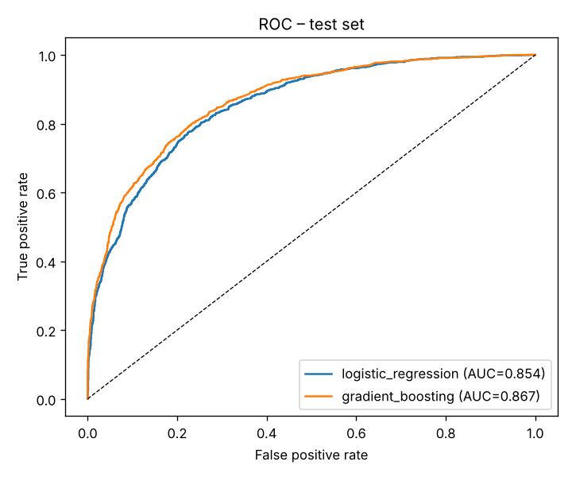
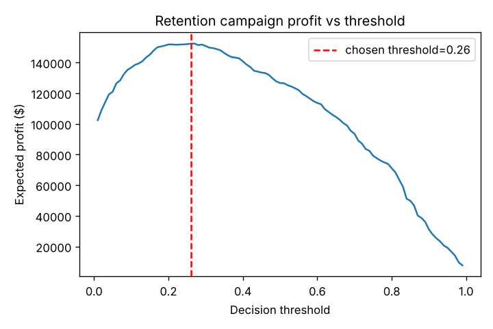
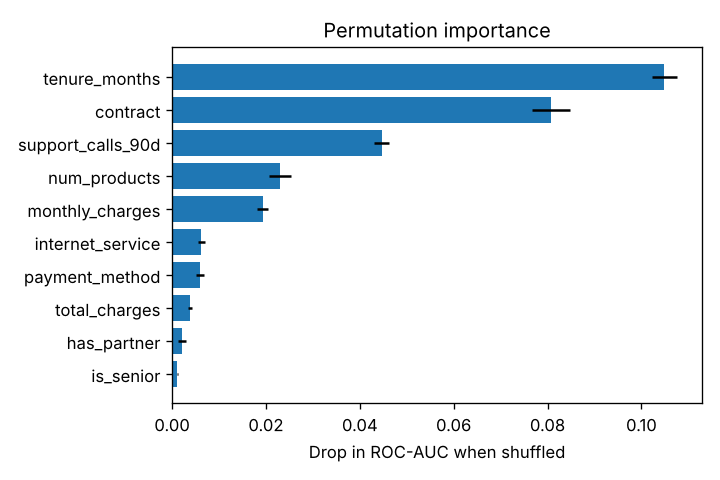

# Customer Churn Prediction with Profit-Optimised Targeting

Predict which telecom customers will cancel, then decide **who should receive a retention offer** by maximising expected campaign profit instead of using a default 0.5 cut-off.



## Why this project is interesting

Most churn notebooks stop at accuracy. In practice, the question a business asks is *"how many customers should we call, and is it worth it?"* This project goes the extra step:

- **Calibrated probabilities** (isotonic calibration) so scores can be treated as real churn risk.
- **Cost-sensitive decision threshold** chosen on a validation set and reported on an untouched test set.
- **Model-agnostic explanations** with permutation importance.
- **Leak-free pipeline** – all feature engineering lives inside a scikit-learn `Pipeline`, so training and serving apply identical transforms.

## Results (test set, 4,000 customers)

| Model | CV ROC-AUC (5-fold) | Test ROC-AUC | Test PR-AUC | Brier score |
|---|---|---|---|---|
| Logistic regression (baseline) | 0.859 ± 0.005 | 0.854 | 0.768 | 0.145 |
| **Gradient boosting + calibration** | **0.864 ± 0.005** | **0.867** | **0.795** | **0.138** |

**Business impact** (offer costs $50, a saved customer is worth $600, 35% of targeted churners accept):

| Strategy | Expected profit |
|---|---|
| Send offer to everyone | $93,790 |
| Default threshold (0.5) | $126,650 |
| **Profit-optimal threshold (0.26)** | **$152,330** (+20% vs 0.5) |



The top drivers recovered by the model – tenure, contract type and recent support calls – match the drivers built into the data generator, which is a useful sanity check that the model learns real signal rather than artefacts.



## Project structure

```
01-customer-churn-prediction/
├── churn/
│   ├── data.py      # synthetic customer generator with known churn drivers
│   └── model.py     # feature engineering, pipelines, profit & threshold logic
├── tests/           # pytest unit tests
├── results/         # metrics.json + figures (generated)
├── train.py         # end-to-end experiment
└── requirements.txt
```

## Quick start

```bash
pip install -r requirements.txt
python train.py            # trains, evaluates, writes results/
python -m pytest -q        # runs tests
```

Options: `python train.py --n 50000 --seed 7`.

## Methodology

1. **Data** – 20,000 synthetic customers with tenure, contract, internet type, payment method, charges and support calls. Churn is generated from a latent model that includes non-linear effects (an onboarding "cliff" in the first 3 months) and interactions (fiber customers with ≥3 support calls), plus 1% missing `total_charges` to mimic real data.
2. **Features** – charges per product, support calls per tenure-year, new-customer flag; one-hot encoding for categoricals; median imputation.
3. **Models** – a regularised logistic regression baseline vs. a histogram gradient-boosting model wrapped in `CalibratedClassifierCV`. The champion is chosen automatically by cross-validated ROC-AUC.
4. **Decision layer** – sweep thresholds on the validation split, pick the one with maximum expected profit, and report profit on the test split.

## Using real data

The pipeline expects the column names in `churn/data.py`. To run on the public IBM Telco Customer Churn dataset, rename its columns to match (`tenure` → `tenure_months`, `Contract` → `contract`, etc.) and replace the `generate_churn_data` call in `train.py` with `pd.read_csv(...)`.

## Tech stack

Python · pandas · NumPy · scikit-learn · matplotlib · pytest
