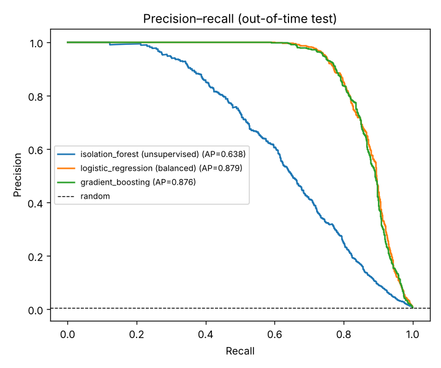

# Real-Time Credit Card Fraud Detection

Detect fraudulent card transactions in a highly imbalanced stream (0.6% fraud) using leak-free **behavioural features**, an **out-of-time validation** split, and metrics that reflect how a fraud team actually works: a fixed daily review budget.



## Highlights

- ~486,000 simulated transactions from 3,000 cardholders over 90 days, each with their own spending level, activity rate and home location.
- **Behavioural features computed only from past data** – amount vs. the customer's historical mean, z-score, time since previous transaction, and 1-hour rolling velocity (count and spend). A unit test proves there is no look-ahead leakage.
- **Out-of-time split** – train on the first 70% of the period, test on the final 30%, mirroring production deployment.
- Compares an **unsupervised** detector (Isolation Forest) against **supervised** models with class weighting.
- Business metrics: precision in the top-K alerts, recall at 1% false-positive rate, and **net dollars saved** under a review budget.

## Results (out-of-time test: 145,946 transactions, $125,965 of fraud)

Analysts can review 0.5% of transactions (730 alerts). Each review costs $5.

| Model | PR-AUC | ROC-AUC | Recall @ 1% FPR | Precision in top 730 | Net $ saved |
|---|---|---|---|---|---|
| Isolation Forest (no labels) | 0.638 | 0.977 | 76.8% | 66.3% | $89,735 |
| Logistic regression (balanced) | **0.879** | **0.992** | **91.2%** | 92.1% | $106,072 |
| Gradient boosting (cost-weighted) | 0.876 | 0.990 | 90.7% | **92.6%** | **$106,618** |

**Ablation:** removing the six behavioural features drops gradient-boosting PR-AUC from 0.876 to **0.830**, showing that customer-relative context matters more than raw transaction attributes.

Key takeaways:
- ROC-AUC looks excellent for every model, but **PR-AUC separates them** – with 0.6% positives, PR-AUC is the honest metric.
- Isolation Forest is a strong fallback when labels are missing or delayed, recovering ~84% of the supervised model's savings without any labels.
- Reviewing just 0.5% of traffic intercepts roughly 85% of fraud dollars.

## Project structure

```
02-credit-card-fraud-detection/
├── fraud/
│   ├── data.py    # transaction simulator + leak-free behavioural features
│   └── model.py   # pipelines and fraud-specific metrics
├── tests/         # includes a no-look-ahead test
├── results/       # metrics.json, pr_curve.png
└── train.py
```

## Quick start

```bash
pip install -r requirements.txt
python train.py
python -m pytest -q
```

## Design notes

- **Why not random train/test split?** Random splits leak future behaviour into training (e.g., a customer's later spending raises their "historical mean"). An out-of-time split is the realistic setup.
- **Why class weighting instead of SMOTE?** Synthetic oversampling distorts probability estimates and interacts badly with time-based features. Class weights get the same effect without fabricating rows.
- **Scoring interface** – `fraud.model.score()` returns a "higher is more suspicious" score for every model family, so supervised and unsupervised models share one evaluation path.

## Extending to real data

The Kaggle "Credit Card Transactions Fraud Detection" dataset (Sparkov simulator) has customer IDs, timestamps, amounts and categories. Map those columns to the schema in `fraud/data.py` and pass the frame to `add_behavioural_features()`.

## Tech stack

Python · pandas · NumPy · scikit-learn · matplotlib · pytest
