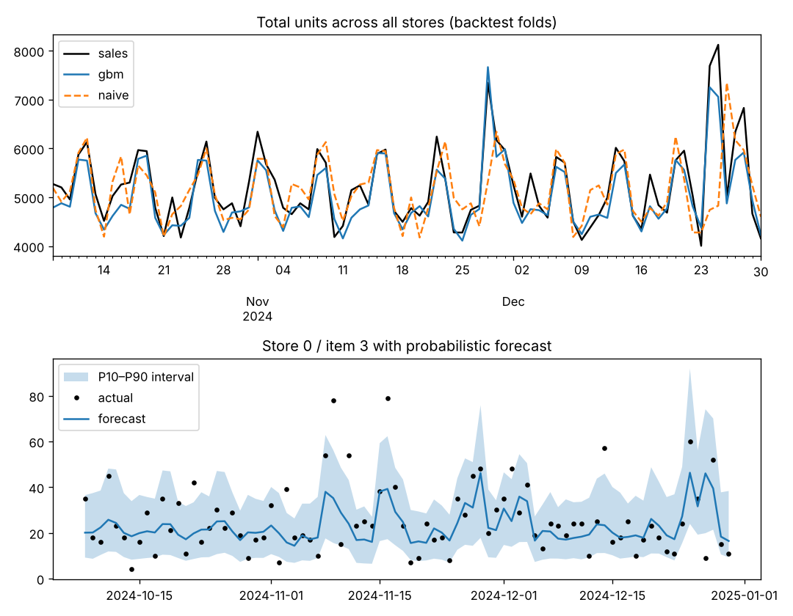

# Retail Demand Forecasting – Global ML Model with Probabilistic Forecasts

Forecast 28 days of daily unit sales for **200 store-item series** with a single global gradient-boosting model, validated by a **rolling-origin backtest**, and produce **P10–P90 prediction intervals** for inventory planning.



## Highlights

- **Global model** – one model learns across all 200 series (10 stores × 20 items), the approach used by top M5-competition solutions, instead of 200 separate ARIMA fits.
- **Direct multi-horizon forecasting** – every target-derived feature is lagged by ≥28 days, so the model forecasts the whole 4-week window with no recursive error accumulation. A unit test tampers with future sales and proves features don't change.
- **Poisson loss** for count data, plus **quantile regression** models for P10 and P90.
- **Future-known covariates** – price, promotions and holidays are planned in advance and used directly.
- Evaluation with retail-standard **WAPE**, forecast **bias**, and **interval coverage**.

## Results (3-fold rolling-origin backtest, 28-day horizon)

| Method | WAPE ↓ |
|---|---|
| Seasonal naive (same weekday, 4 weeks ago) | 0.589 |
| 28-day moving average | 0.457 |
| **Global gradient boosting (Poisson)** | **0.397** |

- **33% lower error** than the seasonal-naive baseline, consistent across all three folds (0.394 / 0.401 / 0.395).
- Forecast bias of **−3.8%** (slight under-forecast).
- P10–P90 intervals cover **78.2%** of actuals vs. a nominal 80% – well calibrated.

WAPE looks high in absolute terms because many series sell only a handful of units per day, where Poisson-type noise is irreducible. Comparisons against baselines are what matter.

## Data

Three years (2022–2024) of daily sales simulated with:
- per-item base demand, trend and yearly seasonality (random phase),
- weekend uplift and Monday dip,
- multi-day promotions with **15–30% discounts and item-specific price elasticity**,
- holiday spikes,
- overdispersed negative-binomial noise (realistic for retail counts).

## Project structure

```
03-retail-demand-forecasting/
├── forecast/
│   ├── data.py       # sales simulator
│   └── features.py   # horizon-safe lags, rolling stats, calendar features, metrics
├── tests/            # includes a leakage test
├── results/          # metrics.json, forecast.png
└── train.py          # rolling-origin backtest
```

## Quick start

```bash
pip install -r requirements.txt
python train.py --folds 3     # ~40 seconds on a laptop
python -m pytest -q
```

## Feature set

| Group | Features |
|---|---|
| Lags | sales 28, 35, 42 and 364 days ago |
| Rolling | 7/28/91-day means and 28-day std, all ending ≥28 days before the target date |
| Seasonal | same-weekday mean over last 4 available weeks; day-of-week; month; Fourier day-of-year terms |
| Known future | price, price relative to regular price, promotion flag, holiday flag |
| IDs | store and item as native categorical features |

## Next steps

- Hierarchical reconciliation so store-level and chain-level forecasts add up.
- Apply to the Kaggle M5 (Walmart) dataset – the schema in `forecast/data.py` maps directly.
- Tweedie loss for intermittent (many-zero) items.

## Tech stack

Python · pandas · NumPy · scikit-learn (HistGradientBoosting, quantile loss) · matplotlib · pytest
