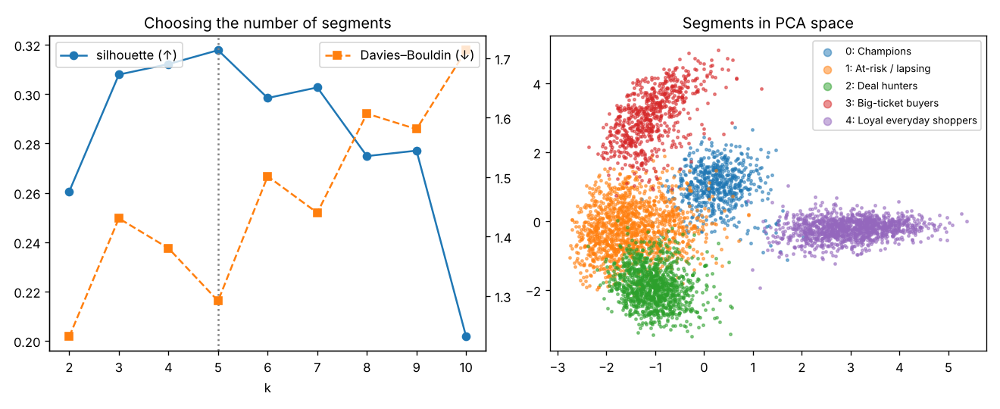

# Customer Segmentation with RFM+ Features and Validated Clustering

Turn a raw e-commerce transaction log into **actionable, stable customer segments**, with a rigorous answer to the questions most clustering projects skip: *How many segments? Are they stable? Are they real?*



## Highlights

- **RFM+ features** from 144,000 transactions: recency, frequency and monetary value per year, average order value, discount usage, category mix and category entropy.
- **Empirical-Bayes shrinkage** of category and discount shares for low-order customers – without it, one-order customers with 0%/100% shares form spurious micro-clusters (silhouette picked k = 10). With it, the true structure emerges.
- **Model selection** across k = 2–10 using silhouette, Davies–Bouldin, inertia and Gaussian-mixture BIC.
- **Bootstrap stability** – re-cluster on 20 bootstrap resamples and measure agreement (ARI).
- **Ground-truth validation** – the data comes from five hidden personas, so we can check whether clustering recovers them (never used for fitting).
- Automatic, rule-based **segment naming** and a segment profile table ready for a marketing team.

## Results

| Check | Result |
|---|---|
| Chosen number of segments (max silhouette) | **5** (matches the 5 hidden personas) |
| Bootstrap stability (mean ARI) | **0.995** – extremely stable |
| Agreement with hidden personas (ARI) | **0.929** |

### Segment profiles (medians)

| Segment | Customers | Revenue share | Recency (days) | Orders / yr | Avg order | Discount use |
|---|---|---|---|---|---|---|
| Loyal everyday shoppers | 1,244 | 34.4% | 4 | 39.1 | $41 | 30% |
| Champions | 614 | 33.6% | 6 | 29.8 | $114 | 17% |
| Big-ticket buyers | 684 | 18.9% | 63 | 2.4 | $623 | 21% |
| Deal hunters | 1,126 | 9.5% | 20 | 11.3 | $43 | 78% |
| At-risk / lapsing | 1,332 | 3.7% | 185 | 2.1 | $63 | 28% |

**Business reading:** 37% of customers (Champions + Loyal) generate 68% of revenue. The 1,332 lapsing customers are a win-back target; deal hunters should receive promotions, while champions don't need discounts to buy.

Full table: [`results/segment_profiles.csv`](results/segment_profiles.csv). Model-selection scores: [`results/k_selection.csv`](results/k_selection.csv).

## Project structure

```
04-customer-segmentation/
├── segmentation/
│   ├── data.py    # transaction simulator with hidden personas
│   └── model.py   # RFM+ features, shrinkage, k selection, stability, naming
├── tests/
├── results/       # metrics.json, segment_profiles.csv, k_selection.csv, segments.png
└── train.py
```

## Quick start

```bash
pip install -r requirements.txt
python train.py
python -m pytest -q
```

## Methodology

1. **Feature engineering** – per-customer aggregates, normalised by tenure so new and old customers are comparable.
2. **Transform** – log1p on skewed monetary/frequency features, then standardisation.
3. **Select k** – silhouette (primary), corroborated by Davies–Bouldin and GMM BIC.
4. **Cluster** – K-Means with 20 initialisations.
5. **Validate** – bootstrap ARI for stability; ARI against hidden personas for correctness.
6. **Profile and name** – median feature values per segment, mapped to business names with transparent rules.

## Using real data

Works directly with the UCI "Online Retail II" dataset: map `Customer ID → customer_id`, `InvoiceDate → timestamp`, `Quantity × Price → amount`, and derive `category` from product descriptions or `StockCode` prefixes.

## Tech stack

Python · pandas · NumPy · scikit-learn (KMeans, GaussianMixture, PCA) · matplotlib · pytest
