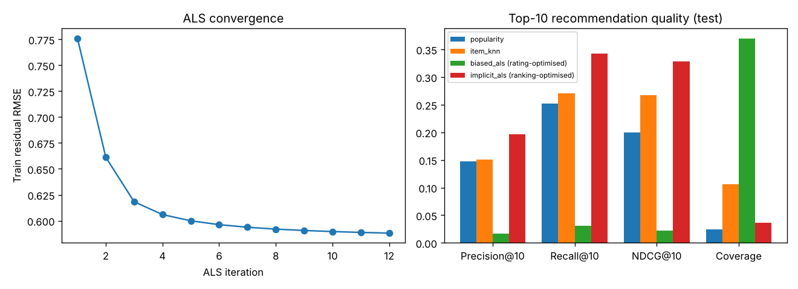

# Movie Recommender System – Matrix Factorisation from Scratch

Four recommendation algorithms implemented **from scratch in NumPy/SciPy** – popularity, item-based kNN, biased explicit ALS, and implicit-feedback ALS – evaluated on both rating prediction (RMSE) and top-10 ranking quality.



## The key finding

> **The model with the best RMSE is the worst recommender.**

Biased ALS predicts star ratings most accurately (RMSE 0.769), yet its top-10 lists are almost useless (NDCG@10 = 0.023). Rating logs are *missing-not-at-random*: people mostly rate what they chose to watch. A rating model happily recommends obscure titles it *thinks* a user would rate well but that the user would never pick. Implicit ALS, which learns from what users did **and didn't** engage with, gives the best ranking by a wide margin. This mirrors a well-known result in the recommender-systems literature (Cremonesi et al., 2010).

## Results

**Data:** 3,000 users × 1,500 movies, ~150,000 ratings (3.3% density). Each user's most recent 20% of ratings are held out (temporal split). Hyper-parameters are tuned on a second temporal split inside the training data.

### Rating prediction (test RMSE, lower is better)

| Model | RMSE |
|---|---|
| Global mean | 1.034 |
| User + item bias baseline | 0.856 |
| **Biased ALS (16 factors)** | **0.769** |

### Top-10 recommendation (test, relevant = rated ≥ 4 stars)

| Model | Precision@10 | Recall@10 | NDCG@10 | MAP@10 | Catalogue coverage |
|---|---|---|---|---|---|
| Most popular | 0.147 | 0.252 | 0.200 | 0.096 | 2.5% |
| Item-kNN (shrunk cosine) | 0.151 | 0.270 | 0.267 | 0.153 | 10.6% |
| Biased ALS (RMSE-optimised) | 0.017 | 0.031 | 0.023 | 0.008 | 36.9% |
| **Implicit ALS (ranking-optimised)** | **0.197** | **0.343** | **0.329** | **0.196** | 3.7% |

Implicit ALS improves NDCG@10 by **64% over popularity** and **23% over item-kNN**. Item-kNN offers a better accuracy/diversity balance (3× the catalogue coverage), a classic trade-off worth discussing in any production setting.

**Sanity check:** user 7's history is dominated by documentaries, animation and drama; their top-10 from implicit ALS contains 4 documentaries and 2 animation titles.

## What's implemented

| Component | Details |
|---|---|
| `BiasBaseline` | μ + b_u + b_i with regularised alternating updates |
| `BiasedALS` | Factorises bias residuals; each step is an exact ridge solve with weighted-λ regularisation |
| `ImplicitALS` | Hu, Koren & Volinsky (2008) with confidence c = 1 + α·r and the YᵀY speed-up trick |
| `ItemKNN` | Mean-centred cosine similarity with significance shrinkage and top-k neighbour pruning |
| `ranking_metrics` | Precision, Recall, NDCG, MAP @k and coverage, excluding already-seen items |
| Data generator | Latent tastes + genre structure, Zipf popularity, and MNAR exposure via Gumbel-top-k sampling |

## Project structure

```
05-movie-recommender-system/
├── recsys/
│   ├── data.py     # rating simulator and temporal split
│   └── models.py   # all four algorithms + metrics
├── tests/
├── results/
└── train.py
```

## Quick start

```bash
pip install -r requirements.txt
python train.py        # ~25 s, includes hyper-parameter search
python -m pytest -q
```

## Using MovieLens

Load `ratings.csv` from MovieLens-100K/1M, re-index `userId`/`movieId` to contiguous integers, and pass the frame to the same `fit()` methods – the column names already match (`user_id`, `item_id`, `rating`, `timestamp`).

## Tech stack

Python · NumPy · SciPy (sparse matrices) · pandas · matplotlib · pytest
