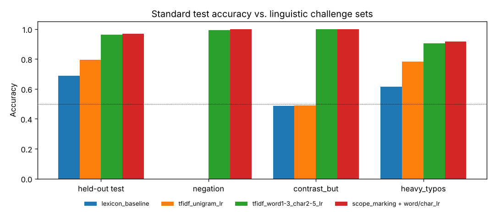

# Product Review Sentiment Analysis with Linguistic Stress Tests

A sentiment classifier for product reviews that goes beyond a single accuracy number: models are probed with **CheckList-style challenge sets** for negation, contrastive "but" clauses and heavy typos, and errors are separated into **label noise vs. genuine model mistakes**.



## Highlights

- **Four models**, from a hand-written lexicon to a word + character n-gram TF-IDF model with **negation- and contrast-scope marking**.
- **Challenge sets** (inspired by Ribeiro et al., *Beyond Accuracy*, ACL 2020) expose failures that a standard test set hides.
- **Noise-ceiling analysis** – reviews carry 3% annotation noise; the true labels are retained so we can tell how much "error" is actually the data's fault.
- **Interpretable** – top weighted n-grams include learned negation features such as `NOT_awful` and `NOT_poor` as *positive* signals.

## Results

20,000 reviews, 80/20 stratified split. Annotation noise caps achievable test accuracy at **97.3%**.

| Model | Test accuracy | Accuracy vs. true labels | ROC-AUC |
|---|---|---|---|
| Lexicon baseline | 0.687 | 0.706 | 0.746 |
| TF-IDF unigrams + LR | 0.793 | 0.809 | 0.890 |
| TF-IDF word 1–3 + char 2–5 grams + LR | 0.963 | 0.990 | 0.973 |
| **+ negation/contrast scope marking** | **0.968** | **0.995** | 0.972 |

### Challenge-set accuracy

| Model | Negation ("not bad") | Contrast ("X, but Y") | Heavy typos (8%) |
|---|---|---|---|
| Lexicon baseline | **0.0%** | 48.8% | 61.4% |
| TF-IDF unigrams | **0.0%** | 49.0% | 78.2% |
| Word + char n-grams | 99.2% | 100% | 90.6% |
| **+ scope marking** | **100%** | **100%** | **91.6%** |

**What this shows**
- Bag-of-words models score ~80% on a normal test set but get **every negated sentence wrong** – a failure invisible in the headline metric.
- Character n-grams make the model robust to misspellings ("relaible", "packagnig").
- 84% of the final model's test "errors" are actually mislabelled reviews. The remaining genuine errors almost all involve **typos inside negation words** ("nto smooth", "i shardly cheap"), which break the negation scope – a concrete next step for improvement.

## Example reviews

```
"Overall, the customer service is awful, but the build quality is not at all awful."  -> positive
"Update: the shippin gis super poor. the keyboard is not at all fantastic."            -> negative
```

## Project structure

```
06-nlp-review-sentiment/
├── sentiment/
│   ├── data.py    # compositional review generator + challenge sets
│   └── model.py   # lexicon, TF-IDF pipelines, scope marking, feature inspection
├── tests/
├── results/       # metrics.json, challenge_sets.png
└── train.py
```

## Quick start

```bash
pip install -r requirements.txt
python train.py
python -m pytest -q
```

Use the trained pipeline on any text:

```python
from sentiment.model import build_models
model = build_models()["scope_marking + word/char_lr"].fit(texts, labels)
model.predict(["The battery is not great, but the screen is fantastic."])
```

## Next steps

- Fuzzy-match negators (edit distance ≤ 1) before scope marking to fix the remaining genuine errors.
- Fine-tune a small transformer (e.g., DistilBERT) and compare on the same challenge sets.
- Apply to real data such as the Amazon Reviews or Yelp Polarity datasets – the pipeline accepts any list of strings.

## Tech stack

Python · scikit-learn (TF-IDF, FeatureUnion, LogisticRegression) · NumPy · pandas · matplotlib · pytest
