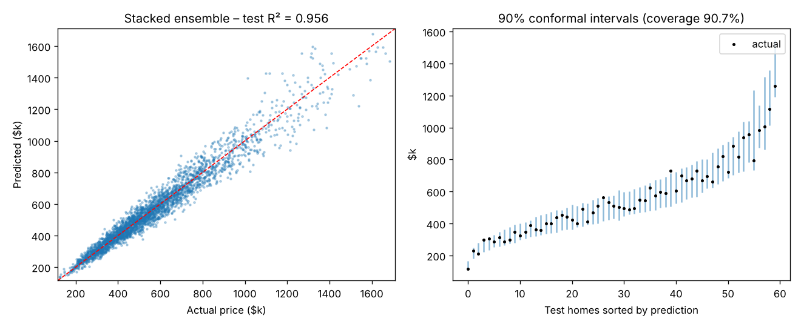
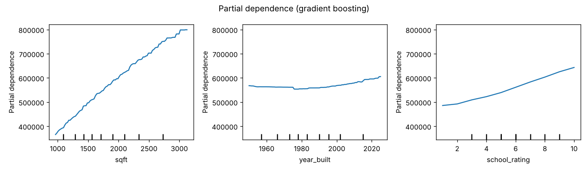

# House Price Prediction – Stacked Ensemble with Conformal Prediction Intervals

Predict home sale prices with a **stacked ensemble** of linear, random-forest and gradient-boosting models, and attach **distribution-free 90% prediction intervals** using split conformal prediction – so every estimate comes with an honest range.



## Highlights

- **Spatial and domain features** – distance and bearing to downtown, size ratios, house age, and a cross-fitted **target encoding** of 40 neighbourhoods (no target leakage).
- **Ridge regression with spline features** captures non-linear effects (e.g., the U-shaped value curve where historic homes regain value) while staying interpretable.
- **Stacking** – a ridge meta-learner combines out-of-fold predictions of the three base models, all in log-price space.
- **Adaptive conformal intervals** – residuals are normalised by a learned difficulty model, so intervals widen for hard-to-price luxury homes, while the calibration step guarantees coverage.
- **Partial dependence plots** to explain how size, build year and school ratings drive price.

## Results (test set, 3,000 homes, median price $513k)

| Model | RMSLE | MAE | MAPE | R² |
|---|---|---|---|---|
| Random forest | 0.114 | $51,540 | 9.0% | 0.923 |
| Gradient boosting | 0.092 | $41,483 | 7.3% | 0.951 |
| Ridge + splines | 0.087 | $40,172 | 7.0% | 0.954 |
| **Stacked ensemble** | **0.086** | **$39,593** | **6.9%** | **0.956** |

The data's irreducible noise corresponds to an RMSLE of about **0.081**, so the ensemble captures nearly all learnable signal. The meta-learner assigns weights of 0.69 to ridge, 0.35 to gradient boosting and ≈0 to random forest – a useful reminder that a well-specified linear model can beat tree ensembles on smooth, multiplicative problems.

### Prediction intervals (target 90%)

| Group | Coverage | Median width (relative to prediction) |
|---|---|---|
| All test homes | **90.7%** | ±15% (30.9% total) |
| Typical homes | – | 30.9% |
| Large homes (> 3,500 sq ft) | 84.2% | 37.6% |

Overall coverage matches the guarantee. Intervals adapt by widening for large homes; their conditional coverage still falls a little short, which is expected – split conformal guarantees *marginal* coverage only. Group-conditional (Mondrian) conformal prediction would fix this.



## Project structure

```
07-house-price-prediction/
├── housing/
│   ├── data.py    # spatial housing-market simulator
│   └── model.py   # features, base models, stacking, SplitConformal
├── tests/         # includes a conformal coverage test
├── results/
└── train.py
```

## Quick start

```bash
pip install -r requirements.txt
python train.py        # ~1 minute
python -m pytest -q
```

Getting an interval for new listings:

```python
from housing.model import SplitConformal, build_models
conf = SplitConformal(build_models()["gradient_boosting"], alpha=0.1).fit(X_fit, y_fit, X_cal, y_cal)
low, high = conf.predict_interval(new_listings)
```

## Using real data

Compatible with the Kaggle "House Prices – Advanced Regression Techniques" (Ames) or King County datasets: map size, rooms, year built and location columns to the names in `housing/data.py`. For King County, convert latitude/longitude into kilometres from the city centre.

## Tech stack

Python · scikit-learn (StackingRegressor, TargetEncoder, SplineTransformer, HistGradientBoosting) · NumPy · pandas · matplotlib · pytest
