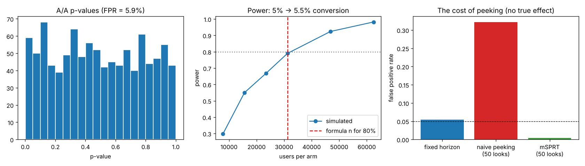

# A/B Testing & Experimentation Framework

A statistically rigorous toolkit for online experiments – **power analysis, frequentist and Bayesian tests, CUPED variance reduction, always-valid sequential testing, and sample-ratio-mismatch checks** – with simulation studies proving that each method behaves as advertised.



## What's inside

| Capability | Function | Why it matters |
|---|---|---|
| Sample-size planning | `sample_size_proportions` | Decide test duration *before* launching |
| Sample-ratio mismatch | `srm_check` | Catches broken randomisation or logging – the #1 silent experiment killer |
| Two-proportion z-test | `ztest_proportions` | Conversion-rate tests with confidence intervals |
| Welch t-test | `welch_ttest` | Revenue per user with unequal variances |
| **CUPED** | `cuped` | Uses pre-experiment data to cut variance (Microsoft, Deng et al. 2013) |
| Bootstrap | `bootstrap_ci` | CIs for medians and other non-standard metrics |
| Bayesian A/B | `bayesian_proportions` | P(B > A), expected loss, credible intervals |
| **Sequential testing (mSPRT)** | `msprt_statistic` | Peek at results any time without inflating false positives (Optimizely, Johari et al. 2017) |

## Simulation studies – does the toolkit work?

### 1. The cost of peeking (2,000 simulated experiments with **no** real effect)

| Stopping rule | False-positive rate (target 5%) |
|---|---|
| Single test at the planned end | 5.4% ✅ |
| **Naive peeking: z-test at 50 interim looks** | **32.2%** ❌ |
| mSPRT at the same 50 looks | 0.4% ✅ |

Checking a dashboard daily and stopping at the first "significant" result makes **one in three** null experiments look like a win. mSPRT fixes this. With a real 10% lift, mSPRT still detects it in 90% of experiments and stops at a median of 13,200 users per arm (vs. 30,000 planned).

### 2. A/A tests
1,000 A/A tests produce a 5.9% false-positive rate and uniformly distributed p-values – the test is correctly calibrated (5% ± sampling noise).

### 3. Power curve
Simulated power at the formula's recommended sample size (31,234 per arm) is **79%** vs. the 80% target.

## Example experiment read-out

80,000 simulated shoppers; true effect: +8% relative conversion lift.

| Check / metric | Result |
|---|---|
| SRM check | p = 0.60 – split is healthy |
| Conversion A → B | 3.86% → 4.36%, **+12.9% lift**, 95% CI [+0.22, +0.77] pp, p = 0.0004 |
| Bayesian | P(B > A) = 99.98%; 95% credible interval for lift: [+5.6%, +20.7%] |
| Revenue / user (raw) | +$0.12, p = 0.35, CI width $0.52 |
| **Revenue / user (CUPED)** | +$0.22, p = 0.059, CI width **$0.45** – **25% variance reduction** |

**Reading it like a senior analyst:**
- The test was planned for 61,119 users per arm but stopped at ~40,000. The observed +12.9% lift overstates the true +8% – a textbook case of the **winner's curse** in under-powered tests. The credible interval still contains the truth.
- CUPED doesn't change *what* is measured, only how precisely: the same data gets a 13% narrower confidence interval for free.

## Project structure

```
08-ab-testing-framework/
├── abtest/
│   ├── stats.py      # all statistical methods
│   └── simulate.py   # experiment simulator with pre-period data
├── tests/            # checks against textbook values and scipy
├── results/          # report.json, validation.png
└── run_analysis.py   # read-out + simulation studies
```

## Quick start

```bash
pip install -r requirements.txt
python run_analysis.py
python -m pytest -q
```

```python
from abtest.stats import ztest_proportions, bayesian_proportions, srm_check
srm_check(10_120, 9_880)
ztest_proportions(conv_a=410, n_a=10_120, conv_b=468, n_b=9_880).as_dict()
bayesian_proportions(410, 10_120, 468, 9_880)
```

## Tech stack

Python · NumPy · SciPy · pandas · matplotlib · pytest
