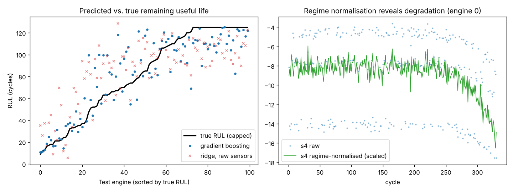

# Predictive Maintenance – Remaining Useful Life of Jet Engines

Predict how many operating cycles a turbofan engine has left before failure from 14 noisy sensors recorded across **three flight regimes**, in the style of NASA's C-MAPSS benchmark, and turn predictions into a **maintenance alert policy**.



## Highlights

- **Run-to-failure simulator** – 200 training engines (≈50,000 cycles) and 100 test engines truncated at random points, with exponential degradation that starts at a different time for each engine, manufacturing offsets, and sensors that carry no signal.
- **Operating-regime normalisation** – operating settings are clustered with K-Means and each sensor is standardised *within* its regime. This lifts the best sensor's correlation with RUL from 0.35 to 0.73.
- **Data-driven sensor selection** with a prognosability score (|Spearman ρ| with RUL in late life).
- **Causal window features** – rolling means (10/30 cycles), rolling std, exponentially weighted mean and 30-cycle least-squares slope per sensor. A unit test proves features never use future cycles.
- **Piecewise-linear target** (RUL capped at 125) – the standard approach, since early-life health is unobservable.
- **Engine-grouped cross-validation** and the asymmetric **NASA PHM08 score**, which penalises late predictions more than early ones.

## Results (100 unseen test engines, prediction at last observed cycle)

| Model | RMSE (cycles) ↓ | NASA score ↓ |
|---|---|---|
| Predict training mean | 40.2 | 28,248 |
| Ridge on raw last-cycle sensors | 24.5 | 2,005 |
| Ridge on regime-normalised window features | 22.9 | 1,651 |
| **Gradient boosting on regime-normalised windows** | **18.8** | **966** |

- Gradient boosting cuts RMSE by **53%** vs. the baseline and the NASA score by **97%**.
- Engine-grouped 5-fold CV RMSE over all training cycles: **17.2**, consistent with the test result (no leakage between engines).
- These numbers are in the same range as published classical-ML results on C-MAPSS (RMSE ≈ 16–25).

### Maintenance alert policy

Alert when predicted RUL ≤ 25 cycles (5-cycle safety margin) for engines that truly have ≤ 20 cycles left:

| Recall | Precision |
|---|---|
| **100%** (7 of 7 engines caught) | 64% |

No engine near failure is missed; the cost is a few early inspections – the right trade-off when a missed failure is far more expensive than an early check.

## Project structure

```
09-predictive-maintenance-rul/
├── pdm/
│   ├── data.py       # fleet run-to-failure simulator
│   └── features.py   # regime normaliser, prognostic score, window features, NASA score
├── tests/            # causality, normalisation and scoring tests
├── results/
└── train.py
```

## Quick start

```bash
pip install -r requirements.txt
python train.py        # ~20 seconds
python -m pytest -q
```

## Using the real NASA C-MAPSS data

Download C-MAPSS from the NASA Prognostics Data Repository. Name the columns `engine_id, cycle, setting1-3, s1-s21`, compute `rul = max_cycle - cycle` for training units, and pass the frames to `RegimeNormalizer` and `window_features`. FD002 and FD004 have six operating regimes – set `RegimeNormalizer(n_regimes=6)`.

## Tech stack

Python · pandas · NumPy · scikit-learn (KMeans, HistGradientBoosting, GroupKFold) · matplotlib · pytest
