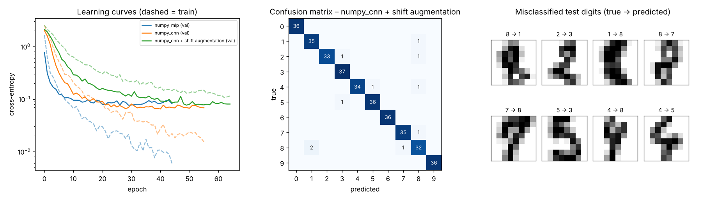

# Neural Networks from Scratch – MLP & CNN in Pure NumPy

A small deep-learning library written **from first principles in NumPy** – dense, convolutional, pooling and dropout layers with hand-derived backpropagation, the Adam optimiser and a training loop – verified by **numerical gradient checks** and benchmarked on real handwritten digits.



## What's implemented

| Component | Notes |
|---|---|
| `Dense` | He initialisation, full backward pass |
| `Conv2D` | Vectorised **im2col** convolution using stride tricks; col2im scatter-add for the backward pass |
| `MaxPool2D` | 2×2 pooling, gradient routed to the max (ties split evenly) |
| `ReLU`, `Dropout`, `Flatten` | Inverted dropout – no rescaling needed at inference |
| `softmax_cross_entropy` | Numerically stable log-sum-exp with fused gradient |
| `Adam` | Bias-corrected moments plus decoupled weight decay (AdamW) |
| Training loop | Mini-batches, cosine learning-rate schedule, early stopping with best-weight restore |
| Augmentation | Random ±1-pixel translations |

No PyTorch, TensorFlow or autograd – every gradient is written by hand.

## Correctness first

Every layer's analytic gradients are compared with **central-difference numerical gradients** (`tests/test_nn.py`) for weights, biases *and* inputs, including the convolution and pooling layers. The test suite also confirms the network can perfectly memorise a small random dataset – a standard sanity check that the optimisation loop works.

## Results

Dataset: the UCI handwritten digits set bundled with scikit-learn (1,797 real 8×8 grayscale images). Split 60/20/20 into train/validation/test, stratified. Neural-network results are the **mean ± std over 5 random seeds**, because on a 360-image test set one image equals 0.28 percentage points.

| Model | Test accuracy | Parameters | Train time / run |
|---|---|---|---|
| Logistic regression (scikit-learn) | 96.4% | 650 | < 0.1 s |
| MLP 256-128 (scikit-learn reference) | 96.2% ± 0.9 | 50,826 | 0.5 s |
| **MLP 256-128 (this library)** | **97.2% ± 0.4** | 50,826 | 1.2 s |
| **CNN (this library)** | **97.7% ± 0.4** | 13,706 | 6.5 s |
| **CNN + shift augmentation (this library)** | **98.1% ± 0.8** | 13,706 | 9.0 s |

Takeaways:
- The from-scratch MLP matches and slightly beats scikit-learn's identical architecture, thanks to dropout, AdamW and cosine decay.
- The CNN reaches higher accuracy with **3.7× fewer parameters** than the MLP – weight sharing and translation invariance at work.
- Augmentation helps on average but adds variance on such a small dataset. Remaining mistakes are mostly genuinely ambiguous 8×8 shapes (see the figure).

## Project structure

```
10-neural-network-from-scratch/
├── nn/
│   ├── layers.py   # Dense, Conv2D (im2col), MaxPool2D, ReLU, Dropout, Flatten, loss
│   └── model.py    # Sequential, Adam, training loop, model builders, augmentation
├── tests/          # numerical gradient checks
├── results/        # metrics.json, training_report.png
└── train.py
```

## Quick start

```bash
pip install -r requirements.txt
python train.py        # ~90 s on a laptop CPU (5 seeds × 3 models)
python -m pytest -q
```

```python
from nn.model import build_cnn
model = build_cnn()
history = model.fit(X_train.reshape(-1, 1, 8, 8), y_train,
                    X_val.reshape(-1, 1, 8, 8), y_val, epochs=80)
model.predict(X_test.reshape(-1, 1, 8, 8))
```

## Next steps

- Batch normalisation and residual connections.
- Scale to MNIST (28×28) – the layers are shape-agnostic; only `build_cnn`'s dense input size changes.

## Tech stack

Python · NumPy (all model code) · scikit-learn (data loading and reference models only) · matplotlib · pytest
